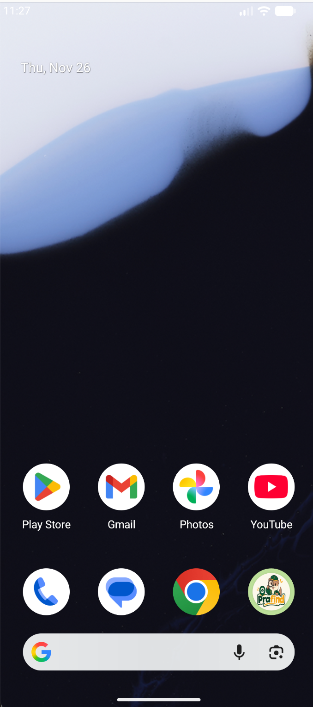

# Dokumentasi Pertemuan 10 — Release Candidate & Pengujian (`PraFind Mobile`)

## 1. Informasi Rilis & Artefak Build

| Atribut | Keterangan |
| :--- | :--- |
| **Nama Aplikasi** | PraFind (`pradita_find_mobile` — Aplikasi Barang Hilang Kampus Pradita) |
| **Versi & Tag Rilis** | `v1.0.0-rc.2` (`version: 1.0.0+2`) |
| **Commit Hash** | `419ad03` (branch `main`) |
| **Repositori GitHub** | `https://github.com/Dherlyaa/PraFind` |
| **Artefak Build** | `build/app/outputs/flutter-apk/app-release.apk` (Terlampir di GitHub Releases `v1.0.0-rc.2`) |
| **Lingkungan Uji Utama** | Android Emulator `Medium_Phone_API_37.0` (Android API 37) |
| **Endpoint Backend** | `https://6ae42e2d933120ae20f98e78.mockapi.io/reports` |

---

## 2. Pembaruan Teknis & Perbaikan Build Release

1. **Implementasi Sistem Logging & Global Error Handler:**
   * Menambahkan utilitas `AppLogger` dengan format terstruktur `[PraditaFind][LEVEL][Module]` (`INFO`, `WARN`, `ERROR`) serta *global error handler* pada `main.dart` (`FlutterError.onError` dan `PlatformDispatcher.instance.onError`).
   * Mengintegrasikan pelacakan aktivitas pada `LoginPage`, `CreateReportPage`, dan `ReportRepository` untuk memudahkan pemantauan melalui `adb logcat` pada mode rilis.

2. **Perbaikan Izin Jaringan & Ikon Material pada Mode Rilis:**
   * Menambahkan `<uses-permission android:name="android.permission.INTERNET" />` dan `<uses-permission android:name="android.permission.ACCESS_NETWORK_STATE" />` pada `android/app/src/main/AndroidManifest.xml` untuk mengatasi galat `SocketException: Failed host lookup` saat mengakses MockAPI pada APK *release*.
   * Menambahkan `uses-material-design: true` pada `pubspec.yaml` agar seluruh font ikon Material terkemas sempurna di dalam APK *release*.

3. **Integrasi Logo Kustom & Adaptive Launcher Icon:**
   * Menambahkan aset logo resmi `assets/images/logo_prafind.png` yang memadukan maskot Adita dan identitas warna Universitas Pradita.
   
   * Mengonfigurasi `flutter_launcher_icons` (`^0.14.3`) untuk menghasilkan *adaptive launcher icon* Android di berbagai resolusi (`mdpi` hingga `xxxhdpi`).
   * Memperbarui `LoginPage` untuk menampilkan logo `assets/images/logo_prafind.png` dengan `errorBuilder` sebagai *fallback*.

---

## 3. Hasil Verifikasi Otomatis & Pengujian Runtime

### A. Ringkasan Kualitas Kode & Build
* **Analisis Statis (`flutter analyze`):** Lulus tanpa peringatan maupun galat (`No issues found!`).
* **Pengujian Otomatis (`flutter test`):** Seluruh **12 unit test & widget test lulus** (`All tests passed!`), mencakup pengujian model, integrasi HTTP API (`200`, array kosong, `404`, invalid JSON), filter pencarian, validasi form, dan komponen UI.
* **Verifikasi APK (`flutter build apk --release`):** APK berhasil dibangun dan diverifikasi tanda tangan digitalnya (`apksigner verify`).

### B. Jejak Log Runtime (`adb logcat | grep PraditaFind`)
Pengujian alur inti pada emulator `Medium_Phone_API_37.0` menghasilkan jejak log *runtime* berikut:

```text
11-26 23:22:58.229  8832  8832 I flutter : [PraditaFind][INFO][CreateReport] Memulai pengambilan lokasi GPS
11-26 23:23:03.525  8832  8832 I flutter : [PraditaFind][INFO][CreateReport] Lokasi GPS berhasil didapatkan: -6.2607917, 106.61844
11-26 23:24:24.975  8832  8832 I flutter : [PraditaFind][INFO][CreateReport] Membuka pemilih gambar (gallery)
11-26 23:24:26.564  8832  8832 I flutter : [PraditaFind][INFO][CreateReport] Membuka pemilih gambar (gallery)
11-26 23:24:26.795  8832  8832 I flutter : [PraditaFind][ERROR][CreateReport] Gagal mengambil gambar | PlatformException(already_active, Image picker is already active, null, null)
11-26 23:24:36.659  8832  8832 I flutter : [PraditaFind][INFO][CreateReport] Pengambilan gambar dibatalkan pengguna
11-26 23:24:38.667  8832  8832 I flutter : [PraditaFind][INFO][CreateReport] Membuka pemilih gambar (camera)
11-26 23:24:51.149  8832  8832 I flutter : [PraditaFind][INFO][CreateReport] Gambar berhasil dipilih: scaled_a04416c5-36c6-46a6-8e93-3f5f45eff5955131326088575616903.jpg
11-26 23:24:52.217  8832  8832 I flutter : [PraditaFind][INFO][CreateReport] Mengirim laporan baru: "Handphone" (Elektronik)
11-26 23:24:52.217  8832  8832 I flutter : [PraditaFind][INFO][ReportRepository] submitReport dipanggil: Handphone
11-26 23:24:53.218  8832  8832 I flutter : [PraditaFind][INFO][ReportRepository] fetchReports dipanggil (URI: [https://6ae42e2d933120ae20f98e78.mockapi.io/reports](https://6ae42e2d933120ae20f98e78.mockapi.io/reports), query: "")
11-26 23:24:53.219  8832  8832 I flutter : [PraditaFind][INFO][CreateReport] Laporan berhasil disimpan (id: 1795710292217)
11-26 23:24:54.704  8832  8832 I flutter : [PraditaFind][INFO][ReportRepository] Berhasil memuat 3 laporan