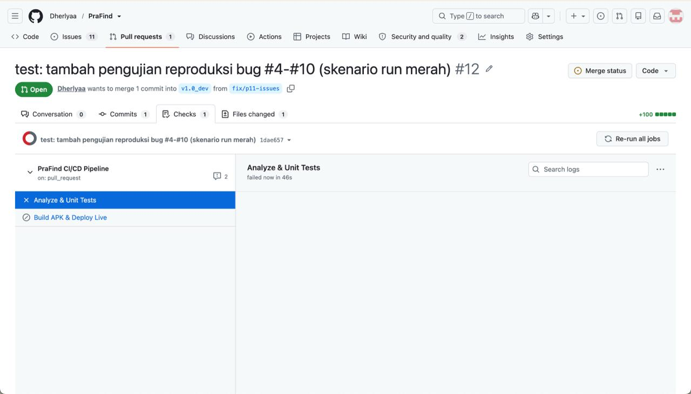
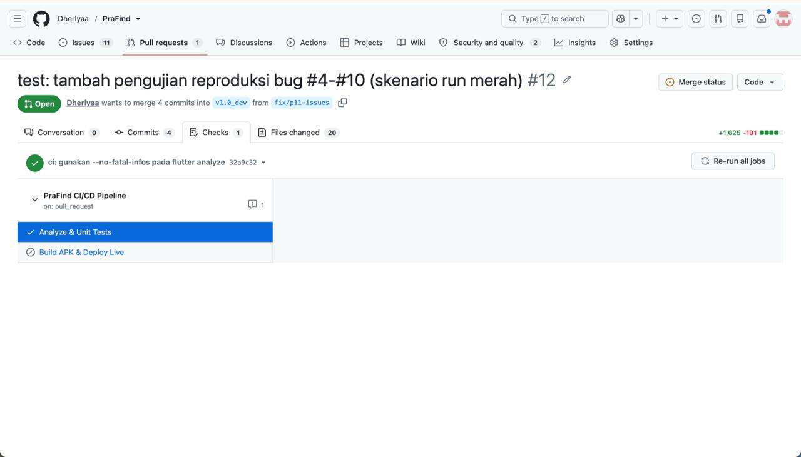
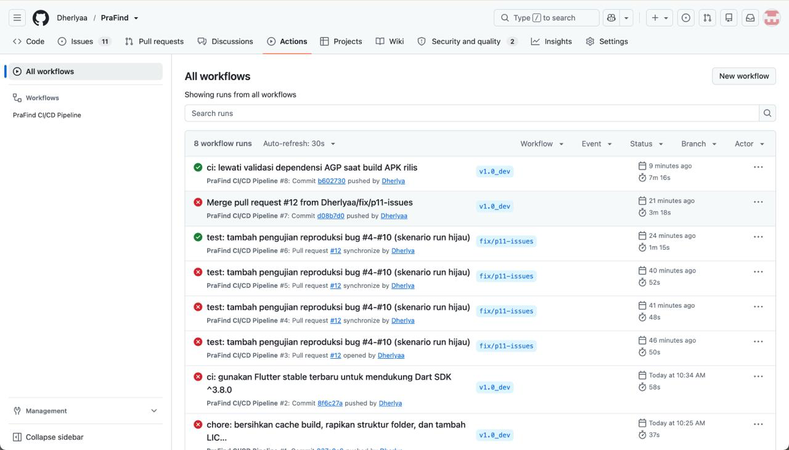
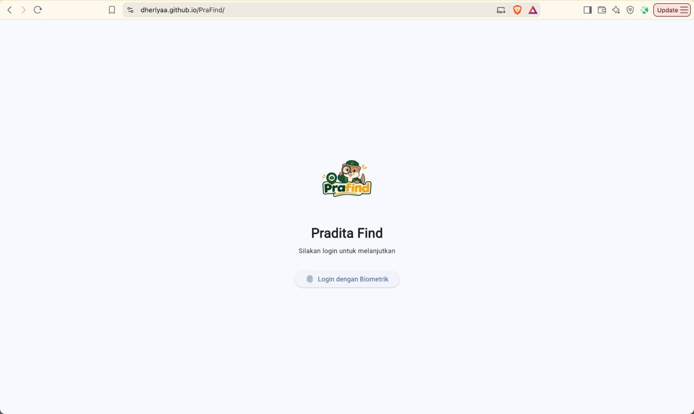

# Laporan Praktikum Pertemuan ke-11 — Manajemen Proyek GitHub, CI/CD, & Pengujian Otomatis (`PraFind`)

- **Nama Proyek:** PraFind (Pradita Find Mobile)
- **Repositori GitHub:** `https://github.com/Dherlyaa/PraFind`
- **URL Live Deployment:** `https://dherlyaa.github.io/PraFind/`
- **Struktur Branch:**
  - `v1.0` — Baseline rilis stabil awal (*Release OK*)
  - `v1.0_dev` — Branch integrasi pengembangan & *auto-deploy* GitHub Pages
  - `V1.1` — Branch rilis berikutnya hasil sinkronisasi perbaikan P11

---

## 1. Penyelesaian 11 GitHub Issues (`#1` – `#11`)

Seluruh 11 isu dari kolaborator (`Jonatan345` dan `Hengkylin`) telah diselesaikan, diverifikasi melalui Pull Request `#12` (`fix/p11-issues` → `v1.0_dev`), dan ditutup (`Closed`):

| No. | Judul Issue | Pelapor | Solusi & Implementasi |
| :--- | :--- | :--- | :--- |
| `#1` | Kebocoran File Build & Cache (Kritis) | `@Jonatan345` | Pembaruan `.gitignore` menyeluruh untuk mengecualikan `build/`, `.dart_tool/`, `.gradle/`, `.idea/`, dan artefak lokal. |
| `#2` | Struktur Proyek Berantakan | `@Jonatan345` | Penataan berkas dokumentasi historis pertemuan ke dalam struktur `docs/pertemuan/` yang konsisten. |
| `#3` | Belum ada License | `@Jonatan345` | Penambahan berkas `LICENSE` (MIT License) pada *root* repositori. |
| `#4` | Pencarian *case-sensitive* & gagal menangani spasi berlebih | `@Jonatan345` | Normalisasi teks pencarian (`trim()`, reduksi spasi ganda, `toLowerCase()`) untuk judul, kategori, lokasi, dan deskripsi di `ReportRepository`. |
| `#5` | Form laporan meloloskan input kosong atau hanya spasi | `@Jonatan345` | Pembaruan `ReportValidator` untuk memvalidasi panjang karakter setelah `.trim()` pada nama barang, lokasi, deskripsi, nama pelapor, dan kontak. |
| `#6` | Laporan bawaan berstatus `"OPEN"` sehingga tombol selesai tidak muncul | `@Hengkylin` | Penambahan enum `ReportStatus` untuk menormalkan status lama `"OPEN"` menjadi `"ACTIVE"`. |
| `#7` | Foto barang yang dipilih tidak ikut tersimpan di laporan | `@Hengkylin` | Penambahan field `imagePath` pada `ReportModel` (`fromJson`/`toJson`) serta penyimpanan `_imageFile?.path` saat pengiriman laporan. |
| `#8` | Laporan baru hilang setelah aplikasi ditutup (hanya di RAM) | `@Hengkylin` | Implementasi persistensi lokal menggunakan `SharedPreferences` yang digabungkan (*merge*) dengan data API pada `ReportRepository`. |
| `#9` | Filter pencarian hilang setelah aksi & hasil pencarian tertukar | `@Hengkylin` | Penyimpanan state `currentQuery`, penerapan *debounce* 300ms, dan pelacakan `_latestRequestId` di `ReportListNotifier`. |
| `#10` | Laporan bisa dihapus tanpa konfirmasi & oleh siapa saja | `@Hengkylin` | Penambahan `AuthSession` untuk validasi `ownerId`, dialog konfirmasi `AlertDialog`, dan `SnackBar` dengan aksi **Urungkan** (*Undo*). |
| `#11` | Halaman detail laporan dengan info kontak pelapor | `@Hengkylin` | Pembuatan `ReportDetailPage` lengkap dengan foto, waktu laporan, identitas pelapor, dan integrasi `url_launcher` menuju WhatsApp/Email/Instagram. |

---

## 2. Konfigurasi CI/CD GitHub Actions (`.github/workflows/ci_cd.yml`)

Pipeline CI/CD dirancang dengan dua tahap berurutan:
1. **`Analyze & Unit Tests`:** Menjalankan `flutter pub get`, `flutter analyze --no-fatal-infos`, dan `flutter test --reporter expanded` pada setiap `push` dan `pull_request` ke `v1.0_dev` serta `main`.
2. **`Build APK & Deploy Live`:** Memiliki dependensi `needs: ci` sehingga hanya berjalan apabila analisis statis dan seluruh pengujian lulus hijau. Tahap ini membangun APK rilis (`app-release.apk`) sebagai artefak dan memublikasikan versi Web ke **GitHub Pages**.

---

## 3. Hasil Eksekusi Unit & Widget Test (212 Pengujian Lulus)

Total **212 pengujian otomatis** (`12` pengujian dasar + `200` pengujian komprehensif P11 di `test/p11_comprehensive_test.dart`) lulus seluruhnya tanpa galat analisis statis:

- **Issue #4 (Pencarian & Normalisasi Spasi):** 35 *unit test*
- **Issue #5 (Validasi Form & Kontak):** 40 *unit test*
- **Issue #6 (Normalisasi `ReportStatus`):** 25 *unit test*
- **Issue #7 (Persistensi Path/URL Foto):** 25 *unit test*
- **Issue #8 (Sinkronisasi Cache `SharedPreferences`):** 25 *unit test*
- **Issue #9 (Retensi Query & Debounce):** 20 *unit test*
- **Issue #10 & #11 (Otorisasi Pemilik & URI Kontak):** 20 *unit test*
- **Pengujian Widget & Integrasi UI:** 10 *widget test*

---

## 4. Bukti Dokumentasi Visual

### 4.1 Pull Request #12 — Run Merah (❌) Sebelum Perbaikan

### 4.2 Pull Request #12 — Run Hijau (✅) Setelah Perbaikan Issues #4–#11 & 212 Tests

### 4.3 GitHub Actions — CI/CD & Auto-Deploy Live Sukses (✅)

### 4.4 Tampilan Live Deployment (`https://dherlyaa.github.io/PraFind/`)
