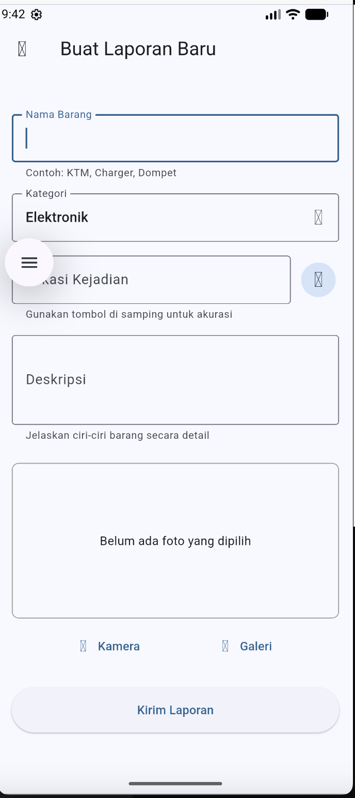
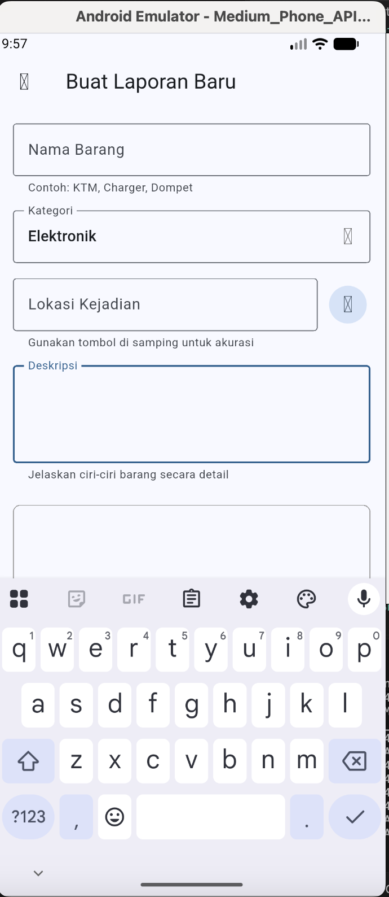
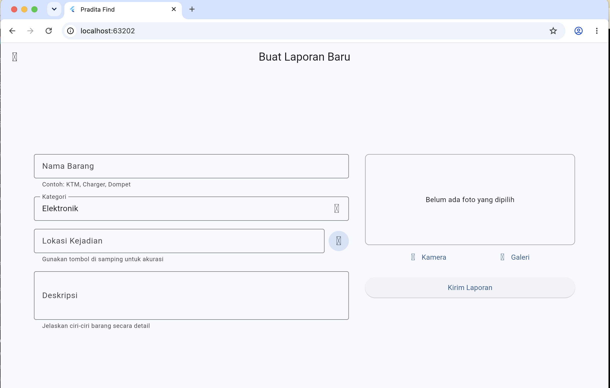
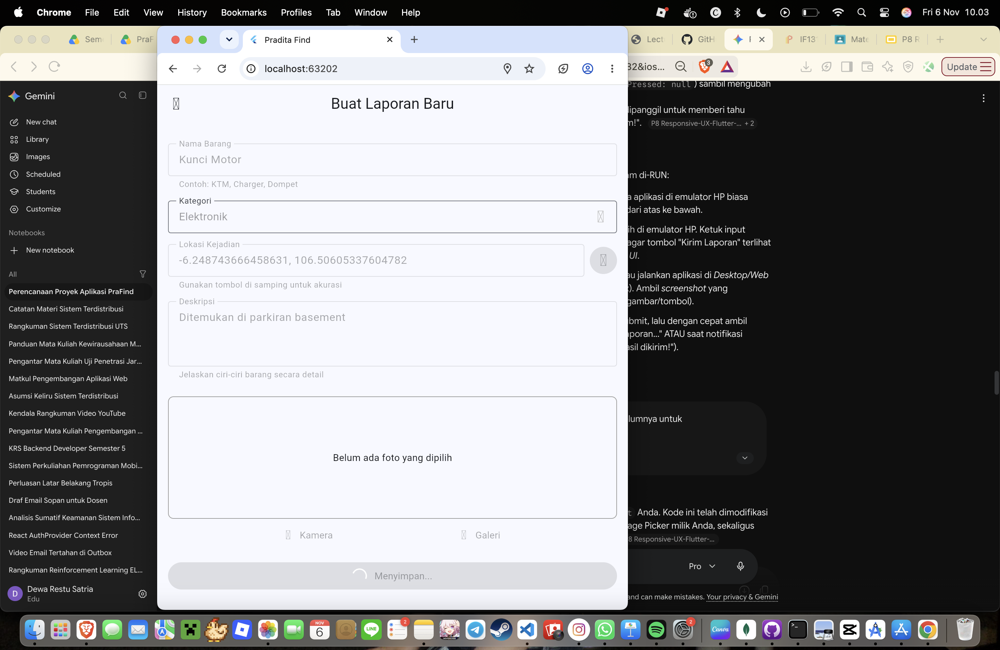

# Laporan Pertemuan 8: Implementasi Responsive UX & Accessibility

**Nama Aplikasi:** Pradita Find (Campus Lost and Found)
**Mata Kuliah:** Pemrograman Mobile / Full-stack

## 1. Deskripsi Singkat
Fokus pada Pertemuan ke-8 ini adalah meningkatkan Kualitas Pengalaman Pengguna (UX) dari aplikasi Pradita Find, khususnya pada halaman formulir pembuatan laporan (`CreateReportPage`). Aplikasi kini telah dioptimalkan agar responsif terhadap berbagai ukuran layar, aman dari penutupan area oleh *keyboard* virtual, memenuhi standar aksesibilitas dasar, dan memberikan *feedback* aksi yang jelas kepada pengguna.

## 2. Pemenuhan 4 Kriteria UX Utama

Sesuai dengan instruksi *reviewer* dan materi presentasi, berikut adalah 4 poin UX yang telah diimplementasikan:

### A. Layout Adaptif (Layar Besar & Kecil)
* **Implementasi:** Menggunakan widget `LayoutBuilder` untuk membaca ruang layar yang tersedia secara dinamis, dipadukan dengan *breakpoint* di lebar `700px`. 
* **Perilaku:** 
  * Pada layar sempit (lebar < 700px, seperti HP), formulir dan area unggah gambar disusun secara vertikal dari atas ke bawah menggunakan `Column`.
  * Pada layar lebar (lebar >= 700px, seperti Tablet atau Web Desktop), tata letak berubah menjadi dua kolom yang berdampingan menggunakan `Row` dan `Expanded` (kolom input di kiri, kolom media di kanan). Lebar maksimal dibatasi menggunakan `ConstrainedBox(maxWidth: 1100)` agar konten tidak terlalu memanjang.

### B. Keyboard-safe UI
* **Implementasi:** Menggunakan kombinasi `Scaffold(resizeToAvoidBottomInset: true)`, `SafeArea`, dan `SingleChildScrollView`.
* **Perilaku:** Saat *keyboard* virtual muncul (misalnya ketika mengetik "Deskripsi"), layar secara otomatis akan mengecilkan area *body* tanpa menutupi kolom input (*scrollable*). Selain itu, fitur `keyboardDismissBehavior: ScrollViewKeyboardDismissBehavior.onDrag` ditambahkan agar pengguna bisa menutup *keyboard* dengan mudah hanya dengan menggeser layar ke bawah.

### C. Accessibility (Aksesibilitas Dasar)
* **Implementasi Label:** Setiap `TextFormField` tidak hanya dilengkapi dengan `labelText`, tetapi juga `helperText` (contoh: "Gunakan tombol di samping untuk akurasi") agar lebih mudah dipahami oleh pengguna maupun *Screen Reader* (TalkBack). Tombol ikon (seperti tombol deteksi lokasi) juga diberikan deskripsi melalui atribut `tooltip`.
* **Implementasi Target Sentuh:** Tombol utama ("Kirim Laporan") telah dipastikan memenuhi standar minimal area sentuh (*Touch Target*) sebesar 48x48 logical pixels dengan menggunakan `minimumSize: const Size.fromHeight(48)`.
* **Penanganan Error:** Pesan *error* validasi disampaikan menggunakan teks yang jelas, tidak sekadar mengandalkan perubahan warna menjadi merah.

### D. Feedback Aksi (Async State)
* **Implementasi:** Menambahkan variabel state `_isSubmitting` untuk melacak proses asinkron saat menekan tombol kirim data.
* **Perilaku:** Saat tombol "Kirim Laporan" ditekan, status berubah. Tombol secara visual akan terkunci (tidak bisa ditekan dua kali) dan teksnya berubah menjadi "Menyimpan..." disertai dengan indikator *loading* (CircularProgressIndicator) di dalamnya. Setelah proses selesai (berhasil/gagal), aplikasi memberikan pemberitahuan yang jelas menggunakan `SnackBar`.

## 3. Penyesuaian Platform (Debugging)

Dalam proses pengujian, kami melakukan dua penyesuaian teknis utama:
1. **Web Bypass untuk Biometrik:** Modul `local_auth` (Pemindai Sidik Jari) memicu `MissingPluginException` jika dijalankan di *browser*. Oleh karena itu, pengecekan platform `kIsWeb` diimplementasikan pada `login_page.dart` untuk melewati gerbang biometrik jika aplikasi di-RUN melalui Chrome. Ini memungkinkan kami untuk menguji UI responsif (Layout Adaptif) langsung di jendela desktop Web.
2. **Konfigurasi Emulator Keyboard:** Memodifikasi file `config.ini` pada *Android Virtual Device* (AVD) dengan mengubah nilai `hw.keyboard=yes` menjadi `no` untuk mematikan deteksi *keyboard hardware* Mac. Hal ini berhasil memunculkan *keyboard* virtual di layar UI emulator untuk kebutuhan pembuktian *Keyboard-safe UI*.

## 4. Hasil Pengujian (Screenshot)
4 *screenshot* pengujian telah berhasil dikumpulkan sebagai bukti lolos kriteria:
1. **Layar Sempit (Keyboard Tertutup):** Menampilkan struktur *default* vertikal (*form* dan *action* tersusun atas-bawah).

2. **Layar Sempit (Keyboard Terbuka):** Membuktikan bahwa input "Deskripsi" tetap terlihat dan bisa di-scroll tanpa tertimpa *keyboard*.

3. **Layar Lebar (>700px):** Diuji menggunakan Chrome Web yang ditarik (resize) jendelanya, membuktikan *layout* membelah otomatis menjadi dua kolom (kanan dan kiri).

4. **Feedback Aksi:** Menangkap momen ketika tombol berubah status menjadi indikator "Menyimpan...".

## 5. Perbandingan Implementasi (Flutter vs React Native)
Sesuai modul P8, terdapat perbedaan cara mengimplementasikan *Layout Adaptif*:
* **Di Flutter:** Kita menggunakan widget `LayoutBuilder` yang mendeteksi ukuran/ruang batas (*constraints*) dari *parent widget*-nya secara lokal, bukan ukuran layar keseluruhan.
* **Di React Native:** Pendekatannya biasanya menggunakan *hooks* `useWindowDimensions` (membaca ukuran jendela secara global) atau properti `onLayout` pada komponen `<View>` untuk menentukan apakah antarmuka harus menggunakan `flexDirection: 'row'` atau `'column'`.