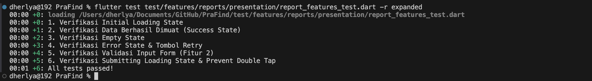
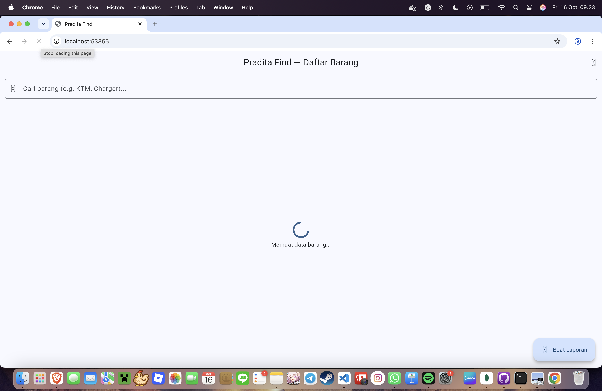
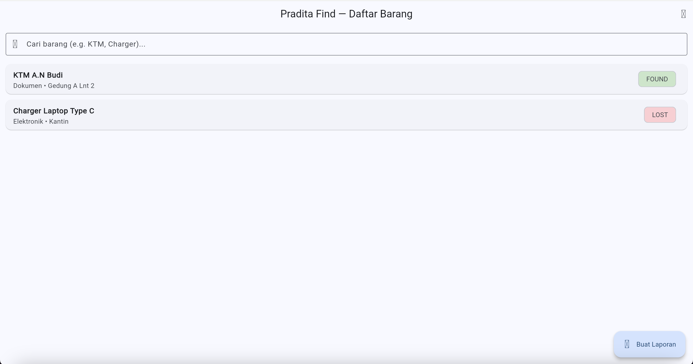
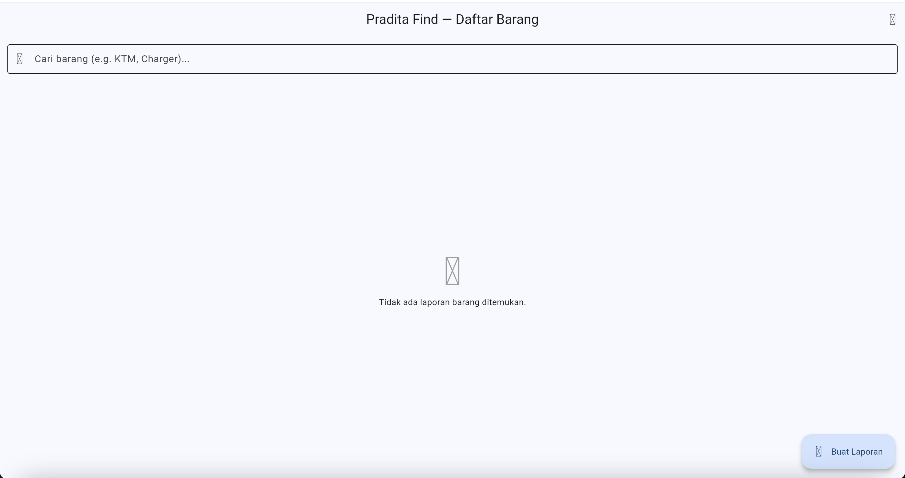
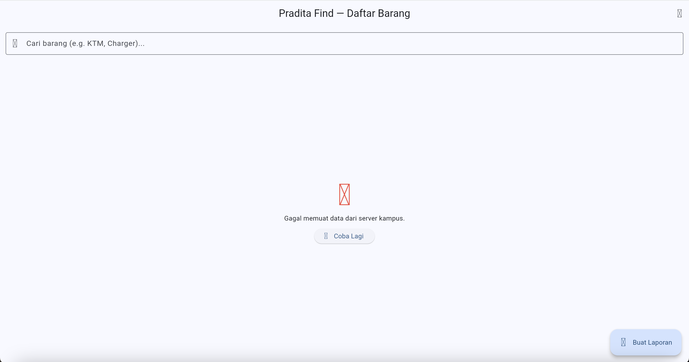
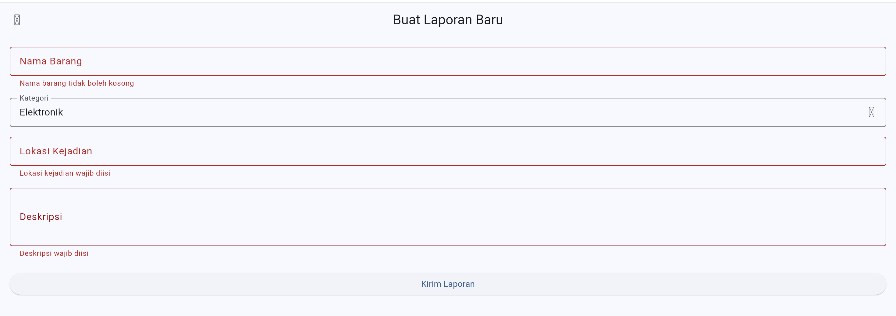
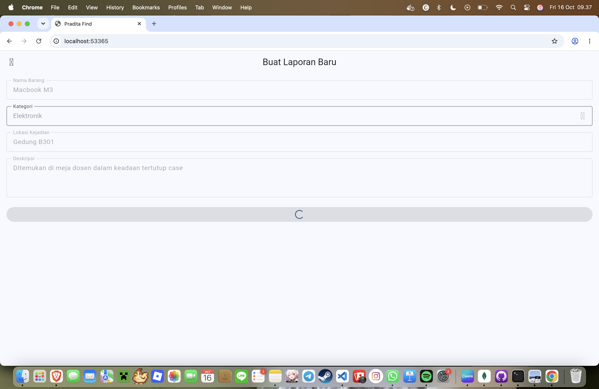

# Laporan Tugas Minggu ke-4 — Flutter State Management & Testing
**Nama Aplikasi:** Pradita Find Mobile
**Framework:** Flutter (Dart)
**State Management:** Riverpod (`StateNotifierProvider`)

---

## 1. Bukti Hasil Widget Test (6 Kondisi UI)

**Daftar Pengujian yang Lulus (100% Passed):**
1. ✓ Initial Loading State

2. ✓ Data Berhasil Dimuat (Success State)

3. ✓ Empty State

4. ✓ Error State & Tombol Retry

5. ✓ Validasi Input pada Form

6. ✓ Submitting Loading State (Prevent Double Tap)

---

## 2. Penjelasan Posisi & Alur Code State Management

* **Posisi Code State Management:**
  - `lib/features/reports/presentation/providers/report_list_provider.dart` (State Management Fitur 1: List & Search)
  - `lib/features/reports/presentation/providers/create_report_provider.dart` (State Management Fitur 2: Form & Submit)
  - `lib/features/reports/data/report_repository.dart` (Layer Data & Mock Repository)

* **Proses Kerja State Management:**
  1. **Widget / UI Layer:** Membaca state menggunakan `ref.watch` dan memicu aksi/event menggunakan `ref.read`.
  2. **Notifier / Business Logic:** `ReportListNotifier` dan `CreateReportNotifier` mengelola state immutable. Saat async request berjalan, state diubah secara bertahap (misal: `submitting` → `success`).
  3. **Prevention of Double Tap:** Saat `CreateReportNotifier.submitReport()` dipanggil, state langsung berubah menjadi `FormSubmitStatus.submitting`. Hal ini membuat parameter `onPressed` pada `ElevatedButton` bernilai `null` (disabled) sehingga pengguna tidak dapat melakukan tap ganda.
  4. **Aktivasi Ulang Otomatis:** Setelah submit berhasil, `CreateReportNotifier` memicu `ref.read(reportListProvider.notifier).loadReports()` untuk menyegarkan tampilan daftar barang secara real-time.

---

## 3. Catatan Penggunaan AI (Gemini / Codex)

* **Prompt AI yang Digunakan:**
  > "Buatkan implementasi 2 fitur Flutter untuk aplikasi Pradita Find menggunakan Riverpod dengan arsitektur pemisahan Widget, Notifier, dan Repository. Fitur 1 mencakup pencarian daftar barang dengan kondisi initial loading, success, empty, dan error state dengan retry. Fitur 2 mencakup form pembuatan laporan dengan validasi input serta submitting loading state untuk mencegah double tap. Sertakan Widget Test lengkap untuk ke-6 kondisi tersebut."

* **Bagian Kode yang Diperiksa & Diperbaiki Sendiri:**
  1. **Penanganan Pending Timer pada Widget Test (`pumpAndSettle`):**
     Menambahkan `await tester.pumpAndSettle()` pada pengujian ke-6 (`test/features/reports/presentation/report_features_test.dart`) untuk menyelesaikan timer `Future.delayed(300ms)` milik repository agar tidak menimbulkan exception `Pending timers` setelah widget tree di-dispose.
  2. **Penguncian Tombol Submit (`onPressed: isSubmitting ? null : _submitForm`)**:
     Memastikan kondisi `isSubmitting` menonaktifkan tombol secara eksplisit di UI `create_report_page.dart` untuk menjamin keamanan *double tap*.